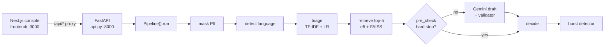

# SentinelDesk: Incident Triage & Grounded Resolution Copilot

SentinelDesk triages raw helpdesk tickets (English or German), decides whether an AI draft is safe or the ticket must go to a human, retrieves similar resolved tickets, and drafts a reply grounded only in those precedents, with `[TKT-xxxxx]` citations.

> Built for the GDG hackathon *SentinelDesk – Autonomous Incident Triage & Grounded Resolution Copilot*.
> Sections marked _TBD_ get filled in as modules land.

## 1. What it does
For every incoming ticket (subject optional + body) the system:
1. **Masks PII** (emails, phones, IPs, account numbers) before any model or LLM sees the text.
2. **Detects language** (`en` / `de`) automatically.
3. **Classifies** `type`, `queue`, and `priority` with a confidence score for each.
4. **Retrieves** the top 5 most similar tickets from the historical knowledge base (cross-lingual: a German ticket can match English precedents).
5. **Gates**: escalates to a human on high-priority incidents, low confidence, no close precedent, unsupported asks (refunds, SLAs, legal), or prompt injection. A hard stop skips the LLM entirely.
6. **Drafts** a reply in the user's language, grounded only in the retrieved precedents and validated for citations.
7. **Detects bursts**: three or more similar incident tickets within 15 minutes raise a **Major Incident Outage** banner.

## 2. Architecture

The Python ML code stays in Python; the frontend only calls the REST API.

| Module | Owner | Role |
|---|---|---|
| `sentineldesk/data.py`, `lang.py`, `triage.py`, `escalation.py` | A | split, language, classifier, escalation gate |
| `sentineldesk/retrieval.py`, `pii.py`, `llm.py`, `generator.py`, `validator.py` | B | retrieval, PII, Gemini generation, grounding check |
| `sentineldesk/pipeline.py`, `burst.py`, `api.py`, `frontend/`, `app.py` | C | orchestration, burst detection, REST API, console |

## 3. Setup
Requirements: Python 3.11+, Node.js 20+.
```bash
pip install -r requirements.txt
cp .env.example .env                 # add GEMINI_API_KEY (optional: template fallback without it)

python -m sentineldesk.data          # build the 80/20 split, prints a fingerprint
python scripts/train_triage.py       # -> models/triage.joblib
python scripts/build_index.py        # -> models/kb.faiss + models/kb_meta.parquet

# terminal 1: API
uvicorn api:app --port 8000
# terminal 2: console
cd frontend && npm install && npm run dev      # http://localhost:3000
```
For the demo, use the production build: `cd frontend && npm run build && npm start`.
If the frontend fails, the Streamlit fallback runs the same pipeline: `streamlit run app.py`.

Tests: `pytest -q` and `cd frontend && npm run lint`.

## 4. REST API
| Method & path | Request | Response |
|---|---|---|
| `POST /api/triage` | `{"subject"?: str, "body": str}` | `PipelineResult` · 422 `{"detail"}` if body is empty |
| `POST /api/burst/simulate` | none | `{"results": PipelineResult[], "burst": {...}}` (4 VPN tickets, EN + DE) |
| `POST /api/burst/reset` | none | `{"ok": true}` |
| `GET /api/examples` | none | `[{"id","label","subject","body"}]` demo presets |
| `GET /api/metrics` | none | `reports/metrics.json`, or `{"available": false}` |
| `GET /api/health` | none | `{"status":"ok","models_loaded":bool,"llm_available":bool}` |

`PipelineResult` = `{ticket_id, language, pii_masked, masked_text, triage, hits, draft, draft_for_human_review, escalation, burst, latency_ms{pii,triage,retrieval,generation,gate,total}}`.

## 5. Holdout metrics
_TBD from `scripts/evaluate.py` (20% holdout split): Macro-F1 for type / queue / priority, High-Priority Incident Recall, escalation rate, p50/p95 latency._

## 6. Escalation rules
Each rule produces a readable reason shown in the console:
1. `priority = high` **and** `type = Incident` (hard stop, LLM skipped)
2. Any classifier confidence below 0.45
3. Top precedent similarity below τ_sim (hard stop) — _threshold TBD_
4. Unsupported or unsafe asks (refunds, compensation, SLA credits, legal, destructive actions) not covered by precedents
5. Prompt injection attempts
6. Draft not grounded according to the validator

## 7. Data leakage statement
The dataset is shuffled with `random_state=42` and split 80/20 exactly as in the problem statement. Only the 80% split is used for training and for the retrieval index. The 20% holdout's `answer`, `type`, `queue`, and `priority` are read **only** by `scripts/evaluate.py`; `tests/test_leakage.py` enforces this and checks that no holdout ticket ID is in the index.

## 8. Hallucination safeguards
- The LLM sees only the PII-masked ticket and the numbered retrieved precedents.
- The prompt forbids inventing pricing, SLAs, refunds, legal guarantees, or integrations.
- The validator drops citations that aren't in the retrieved set; a draft with no valid citations is marked ungrounded and escalated.
- If Gemini is unavailable or times out, an extractive template built from the precedents is used instead.

## 9. Bonus features
- **Cross-lingual retrieval**: multilingual e5 embeddings put EN and DE in one space.
- **PII guardrail**: masking before any model call; the console shows a "PII masked" tag.
- **Outage burst banner**: incident-like tickets with cosine ≥ 0.85 to two or more others in a 15-minute window raise the banner.

## 10. Limitations
_TBD._

## 11. Team
- **A**: skeleton, triage, escalation gate, evaluation
- **B**: retrieval, PII, grounded generation, validator
- **C**: pipeline, REST API, Next.js console, burst detection, demo
